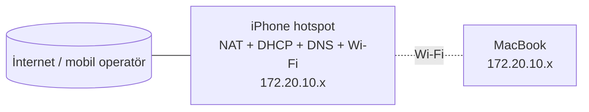

# Phone-Network-Docs

## Goal

To show the network concepts I learned this week (IP, subnet, DNS, port, OSI, DHCP, NAT) on a real network.

I keep a record of what I learn by updating this document in each new course.

## Topology

Current network: iPhone personal hotspot.

## Addressing and DHCP

| Information | Value |

|---|---|

| Network | 172.20.10.0/28 (special address range) |

| Subnet mask | 255.255.255.240 → 16 addresses, 14 available |

| Available range | 172.20.10.1 – 172.20.10.14 (.0 network address, .15 broadcast) |

| Default gateway | 172.20.10.x (the phone itself) |

| DHCP server | 172.20.10.x (same as gateway) |

| DNS server | 172.20.10.x (same as gateway) |

| Lease time | 3600 sec = 1 hour (`0xe10` as hex in the output) |

How I measured it (macOS):

- `networksetup -getinfo Wi-Fi` → IP, mask, router

- `ipconfig getpacket en0` → details of DHCP answer

- `route -n get default` → default gateway

## Devices

| Device | Connection | IP type | Role |

|---|---|---|--|-|

| iPhone | — (the network itself) | Fixed | Gateway, DHCP, NAT, DNS |

| MacBook | Wi-Fi | DHCP | Computer on my study |

## A problem I learned and solved

- I can understand in which network a device is on by looking at the IP address, mask, and gateway.

- `lease_time` is written in hexadecimal (hex) on macOS: `0xe10` = 3600 seconds.

- **Problem:** I saw the mask `172.20.10.x` and `/28` while waiting for addresses like `192.168.1.x`, like a home network.

**Solution:** This is the standard range of the iPhone hotspot. The 1-hour lease period also supported this.

So my computer was connected to the phone, not the home router.

## Sonraki adımlar
- [ ] Ev ağına bağlanıp aynı ölçümleri tekrarlamak, ev ağı bölümünü eklemek
- [ ] Ders 15: SSH
- [ ] Ders 16: Git ile repoyu bilgisayarımdan yönetmek
- [ ] Ders 47: Homelab
